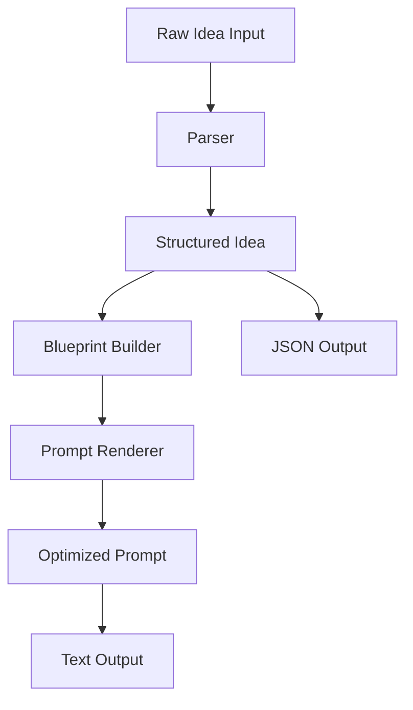

# Prompt Optimizer

Prompt Optimizer converts a raw idea into a structured prompt brief and then generates a production-ready prompt.

## Full Flow

1. Capture the raw idea.
2. Parse explicit fields (goal, audience, constraints, output format, tone).
3. Infer missing structure (problem statement, risks, assumptions).
4. Build a prompt blueprint (task steps + quality bar).
5. Render a final optimized prompt.
6. Return both machine-friendly JSON and human-friendly text.

## Flow Diagram



## Expected Raw Input Style

Free text works, but the parser is best when you include labels like:

- Goal: what outcome is needed
- Audience: who this is for
- Constraints: limits, rules, deadlines
- Output: required output format
- Tone: writing style
- Must Include: mandatory points

Example:

```text
Goal: Build a launch email for a new AI note-taking app
Audience: Startup founders
Constraints: 120 words max, no hype language
Output: Subject line + body
Tone: Clear and practical
Must Include: Product value, one CTA, free trial mention
```

## Install

```bash
pip install -e .
```

## Run

### Terminal-style Web UI (recommended)

```bash
python -m prompt_optimizer.web          # or: prompt-optimizer-web
```

Open http://127.0.0.1:7860 — black/grey/yellow terminal UI. Paste your raw idea,
press Enter, get the optimized prompt with live analysis (task type, clarity,
specificity, completeness scores) and improvement suggestions.
`↑/↓` history, `Shift+Enter` newline, `[copy]` copies the result.

Optional flags: `--host 0.0.0.0 --port 8000`

### CLI

```bash
prompt-optimizer optimize --idea "Goal: Explain our API migration plan to enterprise customers. Constraints: concise. Output: bullet list."
```

Read from a file:

```bash
prompt-optimizer optimize --file idea.txt
```

Add `--json` for machine-readable output (includes the analysis scores).

### API

Start the server with `python -m prompt_optimizer.web`, then call the Prompt Optimizer endpoint:

```bash
curl -X POST http://127.0.0.1:7860/api/prompt-optimizer \
  -H 'Content-Type: application/json' \
  -d '{"idea":"Goal: Build a launch email. Audience: Founders. Constraints: 120 words max. Output: Subject + body."}'
```

Response JSON fields:

- `formatted`: exact text with `**Optimized Prompt:**` (fenced block), `**Assumptions:**`, and optional `**Quick questions (optional):**`
- `optimized_prompt`: prompt text inside the fence
- `assumptions`: list of assumptions made
- `quick_questions`: list of questions (only when the idea is too vague)
- `vague`: true when questions were returned instead of a prompt
- `text`: same as `formatted`

The body also accepts `rawIdea` as the input key. Empty input returns HTTP 400.

## Engine (v1.0)

1. **Parser** — extracts labeled fields, infers the rest, detects task type
   (code / analysis / writing / marketing / planning / learning / design).
2. **Analyzer** — scores clarity, specificity, completeness (0-100) and emits
   concrete suggestions for what would raise the score.
3. **Planner** — task-type-aware process steps, quality bar, output schema,
   and an expert role per domain.
4. **Renderer** — emits a top-1% structured prompt: ROLE / CONTEXT / OBJECTIVE /
   CONSTRAINTS / MUST INCLUDE / PROCESS / OUTPUT FORMAT / QUALITY BAR / TONE,
   closed with an anti-hedging instruction so the model commits to an answer.`
