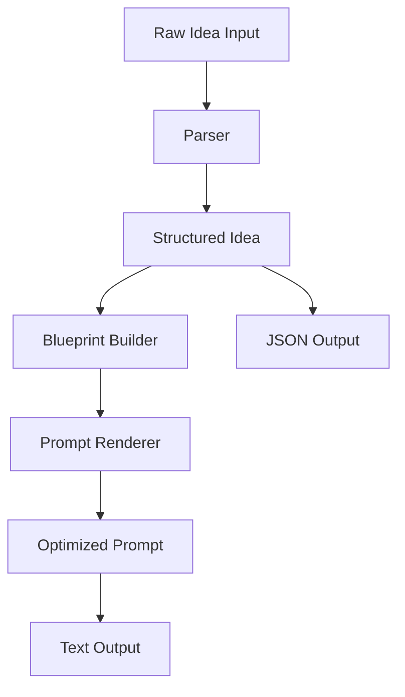

# Prompt Optimizer

Prompt Optimizer converts a raw idea into a structured prompt brief and then generates a production-ready prompt.

## Full Flow

1. Capture the raw idea.
2. Parse explicit fields (goal, audience, constraints, output format, tone).
3. Infer missing structure (problem statement, risks, assumptions).
4. Build a prompt blueprint (task steps + quality bar).
5. Render a final optimized prompt.
6. Return both machine-friendly JSON and human-friendly text.

## Flow Diagram



## Expected Raw Input Style

Free text works, but the parser is best when you include labels like:

- Goal: what outcome is needed
- Audience: who this is for
- Constraints: limits, rules, deadlines
- Output: required output format
- Tone: writing style
- Must Include: mandatory points

Example:

```text
Goal: Build a launch email for a new AI note-taking app
Audience: Startup founders
Constraints: 120 words max, no hype language
Output: Subject line + body
Tone: Clear and practical
Must Include: Product value, one CTA, free trial mention
```

## Install

```bash
pip install -e .
```

## Run

```bash
prompt-optimizer optimize --idea "Goal: Explain our API migration plan to enterprise customers. Constraints: concise. Output: bullet list."
```

Read from a file:

```bash
prompt-optimizer optimize --file idea.txt
```

JSON output:

```bash
prompt-optimizer optimize --file idea.txt --json
```

## Project Layout

```text
src/prompt_optimizer/
  cli.py
  parser.py
  planner.py
  renderer.py
  schemas.py
  workflow.py
tests/
  test_workflow.py
```
